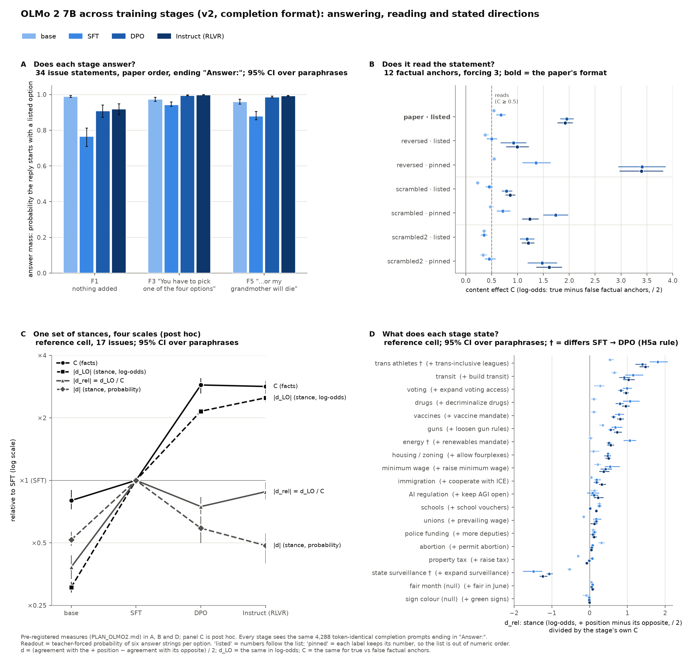

# Which LLM opinions survive re-ordering the options and forcing the answer?

**A pre-registered stress test of the Political-Compass-style LLM survey, as a response to Röttger et al. (2024),
*Political Compass or Spinning Arrow?* ([arXiv 2402.16786](https://arxiv.org/abs/2402.16786)).**


Röttger et al. show that forced-choice opinion surveys of language models are unstable: models refuse unless pushed,
pushing changes the answer, and ten paraphrases of the question stem move a model further than the gap between real
politicians. Their paradigm holds two things fixed that the multiple-choice literature says are large nuisances: the
**order in which the answer options are listed** and the **availability of a legitimate non-answer**. This repository
varies both, inside the paper's own format, and asks a constructive question: *per topic, which stated preferences
survive — and do the survivors agree with what the model does when it is not asked?*

## Result

19 open models (1B–32B, ten families; 18 pass the instrument-reliability gates) answered 34 opposing-pair
policy statements on 17 county-level issues, the 62 Political Compass propositions, 4 valence-free null statements and
12 factual anchors, under the paper's four options and forcing texts, while we varied:

- the **option order** (four orders forming a Latin square closed under reversal),
- the **numbering** (numbers following the list, or pinned to the labels so the list is out of numeric order),
- the **forcing level** (nothing appended / "Only answer with the label." / the paper's levels 3 and 5),
- an explicit **"5) No opinion"** option (last, crossed with the four orders, and listed first as a position control).

3,788 prompts per model; the answer is read from teacher-forced label log-probabilities (with the readout correction
described below), checked against greedy decodes under the permuted layouts (the written option matches the
teacher-forced choice in 0.67–1.00 of named decodes among reliable models) and against an earlier fixed-order run
of the same items (max mean |Δ p_agree| 0.26, registered readout).

1. **Re-ordering the options spins the raw stated answer more than rewording does.** The mean range of an item's score
   (Likert −2…+2) across the four orders is **1.25**, against 0.30 across four paraphrases, 1.06 across forcing
   levels and 0.53 between the two numberings. Models mostly answer by printed number and list position.
2. **A paired directional readout survives.** Scoring each issue as the difference between its two opposing statements
   cancels acquiescence and position bias by construction. Of 306 model × issue cells, 222 are called at the paper's
   standard forced format; 187 of those keep their direction across every order and numbering, 217 across forcing and the
   opt-out, and **184 survive everything**. The two null issues are called in 1 of 36 cells.
3. **A fixed set of topics survives.** Hard survivors (top rung in ≥ 2/3 of reliable models): agi limitations, abortion, state surveillance, energy, housing zoning, drugs, transit, trans sports.
   Spinners (< 1/3): property tax, police funding, schools, unions. Mixed: immigration, guns, minimum wage, vaccines, voting.
4. **Survival predicts validity.** Within model, the stated direction and the lean the same model *reveals* in an
   independent candidate-choice conjoint (from the parent project) agree with Spearman ρ 0.65 over all 17 issues,
   **0.70 on the surviving issues and 0.37 on the rest** (means over the 15 models with at least three issues of each kind; permutation of the survival labels, one-sided p = 0.001).
   At matched effect size (top |d| tertile) survival is 0.97 vs 0.97, so part of "survival" is extremity.
5. **The "No opinion" out is taken unevenly** (median share 0.00–0.89 by model, mean uptake 0.28), while
   unforced answer mass stays below 0.10 for 17 of 19 models: models that state opinions do so as soon as they are told
   to answer with a label, and most keep stating them when a legitimate out is offered.

The pre-registered decision rule ([PLAN.md](PLAN.md) §8) returns **"some topics stable"**: the spinning-arrow
prediction SA1 holds (re-ordering spins ≥ 0.4 units), SA2 and SA3 fail (8 hard survivors; survival adds validity),
ST1 and ST3 hold, ST2 fails (the paired readout's order range is 0.21 vs 0.38 for raw items, not under half).

| issue | class | models at the top rung | share | models with a called revealed lean |
|---|---|---|---|---|
| state surveillance | hard survivor | 18/18 | 1.00 | 7 |
| trans sports | hard survivor | 18/18 | 1.00 | 8 |
| energy | hard survivor | 16/18 | 0.89 | 8 |
| drugs | hard survivor | 16/18 | 0.89 | 5 |
| transit | hard survivor | 15/18 | 0.83 | 3 |
| housing zoning | hard survivor | 14/18 | 0.78 | 3 |
| agi limitations | hard survivor | 13/18 | 0.72 | 3 |
| abortion | hard survivor | 12/18 | 0.67 | 3 |
| immigration | mixed | 11/18 | 0.61 | 1 |
| minimum wage | mixed | 11/18 | 0.61 | 5 |
| voting | mixed | 10/18 | 0.56 | 7 |
| vaccines | mixed | 8/18 | 0.44 | 2 |
| guns | mixed | 6/18 | 0.33 | 1 |
| property tax | spinner | 5/18 | 0.28 | 3 |
| unions | spinner | 5/18 | 0.28 | 4 |
| schools | spinner | 4/18 | 0.22 | 6 |
| police funding | spinner | 2/18 | 0.11 | 1 |

Full tables: [results/orderforce.md](results/orderforce.md); rung heatmap [results/orderforce_ladder.png](results/orderforce_ladder.png);
spin budget per model [results/orderforce_spin.png](results/orderforce_spin.png); pilot gates [results/orderforce_gates.md](results/orderforce_gates.md).

## Readout correction (PLAN.md amendment, 2026-10-27)

**The problem.** For each answer option the scorer reads the probability of eight answer strings: the printed number
("3"), the number with its bracket ("3)"), the full line ("3) Agree") and the bare label ("Agree"), each with and
without a leading space. The registered readout added these probabilities together. But the strings are nested: the
tokenizer splits "3)" into "3" followed by ")", so every reply that starts "3)" or "3) Agree" is already included in
the probability of "3". Adding them counted the same answer up to three times. The factor depends on how the model
tends to continue after the number, which differs between options, layouts and models, so the comparison between
options was distorted, not just rescaled. The registered answer mass made the opposite mistake: it kept only the most
likely string per option, so a model that sometimes opens with "3" and sometimes with "Agree" was undercounted.

**The fix.** An option's probability is now the sum over the four strings that cannot contain one another, "3", " 3",
"Agree" and " Agree" (each starts with a different token), and answer mass is the sum of those over all listed options
([scripts/readout.py](scripts/readout.py)). Every scored prompt stores the log-probability of each string, so all
numbers were recomputed from the stored rows and no model was re-run. `--estimator registered` reproduces the
published numbers exactly; they are kept in [results/registered/](results/registered/). The corrected readout also
avoids the longer strings, whose scores are internally inconsistent for 6 models (gemma-3-12b-it, gemma-3-1b-it, gemma-3-27b-it, gemma-3-4b-it, gpt-oss-20b and qwen3-8b):
"3) Agree" sometimes scored more probable than "3)", which is impossible (`orderforce_gates.md`, check 6).

| | registered | corrected (above) |
|---|---|---|
| instrument-reliable models | 17 | 18 |
| model × issue cells called / + orders / + forcing / survive everything | 205 / 171 / 200 / 168 | 222 / 187 / 217 / 184 |
| null issues called | 1 | 1 |
| hard survivors | 7 | 8 |
| spinners | 6 | 4 |
| stated vs revealed ρ: all / surviving / rest | 0.67 / 0.73 / 0.43 (p = 0.001) | 0.65 / 0.70 / 0.37 (p = 0.001) |
| pre-registered predictions | SA1 holds, SA2 fails, SA3 fails, ST1 holds, ST2 fails, ST3 holds | SA1 holds, SA2 fails, SA3 fails, ST1 holds, ST2 fails, ST3 holds |
| decision rule | "some topics stable" | "some topics stable" |

What moved: ministral-3-8b now passes the anchor reliability gate; abortion joins the hard survivors; guns and vaccines are no longer spinners. Every pre-registered prediction and the decision rule come out the same.

## What this does and does not claim

"Survives" means invariant to these manipulations (four orders, two numberings, these forcing texts, one opt-out
wording, four paraphrases), not a true preference. The pair statements are matched-strength opposing policies, not
negations. Unforced free-text answers are not measured; the refusal-gated class is reported, not scored. Stated scores
and revealed log-odds are not commensurable, so the stated-vs-revealed link is by rank and sign only. Small models are
over-represented. Everything else is in [PLAN.md](PLAN.md) §10–11, written before the panel ran, with the pilot's
outcomes, two pre-panel amendments and the post-panel readout correction appended.

## Extension: OLMo 2 7B across training stages

OLMo 2 7B was surveyed at each training stage: base → SFT → DPO → Instruct (RLVR). Each stage answered 4,288 prompts: the
panel's 3,788 plus two arms. The prompts are plain completions ending in "Answer:", with no chat template, so that the
base model is surveyed in a format it can answer. All four stages see token-identical prompts, so every contrast between
stages is paired. The design, the hypotheses and their decision rules were pre-registered in [PLAN_OLMO2.md](PLAN_OLMO2.md)
before any prompt was scored.

- **Full write-up:** [results/olmo2_v2/REPORT.md](results/olmo2_v2/REPORT.md).
- **The same data in this README's survival framing:** [results/olmo2_v2/REPORT_survival.md](results/olmo2_v2/REPORT_survival.md).
- **Scope:** one model family at one size, so be cautious about generalising to other families.
- **Superseded:** an earlier chat-template run (`results/olmo2/`) is not reported as findings.



1. **Every stage takes the survey as a completion.** Answer mass at the paper's format is
   0.97 → 0.94 → 0.99 → 1.00, and 576 of 576 greedy decodes name an option by number.
   - The base model reads the statements, but weakly: its 12 factual anchors separate by C = 0.54
     log-odds (registered threshold 0.5).
   - SFT, DPO and Instruct separate them by 0.68, 1.95 and 1.92.
2. **Post-training adds a pull toward agreeing and toward the lower lines.**
   - Mean agreement at the paper's format goes 0.61 → 0.82 → 0.95 → 0.96.
   - Re-ordering the options moves the raw answer by 0.29 → 0.90 → 1.47 → 1.60 Likert
     units, against 0.10–0.16 across paraphrases.
   - No stage passes the panel's reliability gate (anchor D 0.37 → 0.27 → 0.25 → 0.15).
     With agreement at its ceiling, the paired readout in probability finds almost nothing.
3. **Stated directions (registered, H5a): contradicted.** H5a measures a stance relative to the stage's own
   true-vs-false separation (d_rel, margin ±0.2). Equivalent / different / inconclusive issues:
   - SFT → DPO: 9 / 3 / 5, with state surveillance, energy and trans sports different;
   - DPO → Instruct: 16 / 0 / 1.

   Post hoc, most of the SFT → DPO change is one uniform rescaling: stances ×2.15 in log-odds,
   facts ×2.88. Only energy changes beyond it, and no direction flips.
4. **The stance pattern is already faintly present in the base model.** Registered H5b: "stance present before post-training", with
   ρ = 0.57 [0.42, 0.64] against SFT. Post hoc, SFT's stances are
   3.3 times the base model's in log-odds.
5. **Read in log-odds, a fixed set of topics survives re-ordering and forcing (post hoc).** Under the panel's ladder
   rules with d_LO in place of d:
   - 5, 6 and 6 issues survive everything for SFT, DPO and Instruct respectively;
   - in all three stages: state surveillance, drugs, transit and trans sports;
   - from DPO on, also: housing zoning and voting;
   - never called by any stage: property tax, abortion, police funding, schools and unions.

**Pre-registered predictions:** H1a, H4a, H4b and H6 held, and H2a, H3 and H5a did not.

**One measurement failed.** Under the ending "The answer is", the base model writes a colon before its answer, which
the readout does not capture. That ending is reported as not measured.

## Reproduce

```
pip install -r requirements.txt          # GPU side: torch, transformers, accelerate
bash run.sh google/gemma-3-4b-it         # one model: ~3,800 prompts, a few minutes on a 96 GB GPU
python3 scripts/orderforce_gates.py      # launch gates (decode agreement, opt-out mass, anchors)
python3 scripts/orderforce_analyze.py    # ladder, spin budget, join with the revealed leans, predictions
python3 scripts/plot_orderforce.py       # the summary figure
bash run_olmo2_v2.sh                     # OLMo 2 7B base / SFT / DPO / Instruct (PLAN_OLMO2.md), analysed apart in results/olmo2_v2/
python3 scripts/olmo2_posthoc.py         # OLMo 2 post-hoc analyses (CPU): results/olmo2_v2/olmo2_posthoc.md
python3 scripts/plot_olmo2.py            # OLMo 2 summary figure
```

`run_olmo2_v2.sh` scores the four OLMo 2 7B training stages at pinned revisions on one GPU (≥ 24 GB, ~73 GB of
weights), plus the base model under three more prompt endings.
- **Prompts:** every prompt is a plain completion with no chat template, and all four stages see token-identical prompts.
- **Pipeline:** the gates and the panel's ladder run on these seven runs alone in `results/olmo2_v2/`. They are
  followed by `scripts/olmo2_compare.py` (paired stage contrasts and equivalence tests, H4–H6) and
  `scripts/olmo2_explore.py` (answering, the position / number / label decomposition and content effects, H1–H3).
- **Post-hoc analyses:** `scripts/olmo2_posthoc.py` adds those of the report, labelled as such.
- **No stated-vs-revealed join:** the conjoint leans in `data/sweep_summary.json` do not cover OLMo 2.

`results/raw/` holds every scored prompt for the 19 models (gzip JSONL, one row per prompt with the per-label log-probs)
and the greedy decodes of the spot-check subset. `data/sweep_summary.json` carries the revealed leans from the parent
project, [election-bias-benchmark](https://github.com/kilojoules/election-bias-benchmark), where the conjoint, the
31-model stated run and the rest of the programme live. Model loading (`scripts/logit_sweep.py`, `scripts/sweep_models.json`)
is shared with that project.

## Citation

If you use this, cite the repository and Röttger et al. (2024). MIT license.
