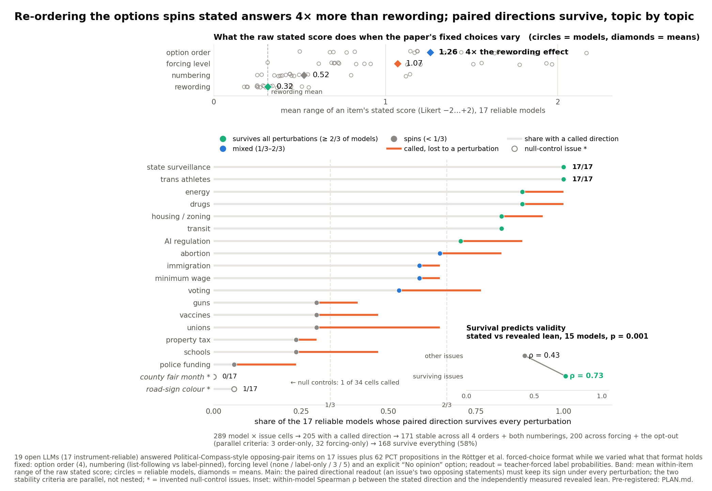

# Which LLM opinions survive re-ordering the options and forcing the answer?

**A pre-registered stress test of the Political-Compass-style LLM survey, as a response to Röttger et al. (2024),
*Political Compass or Spinning Arrow?* ([arXiv 2402.16786](https://arxiv.org/abs/2402.16786)).**



Röttger et al. show that forced-choice opinion surveys of language models are unstable: models refuse unless pushed,
pushing changes the answer, and ten paraphrases of the question stem move a model further than the gap between real
politicians. Their paradigm holds two things fixed that the multiple-choice literature says are large nuisances: the
**order in which the answer options are listed** and the **availability of a legitimate non-answer**. This repository
varies both, inside the paper's own format, and asks a constructive question: *per topic, which stated preferences
survive — and do the survivors agree with what the model does when it is not asked?*

## Result

19 open models (1B–32B, ten families; 17 pass the instrument-reliability gates) answered 34 opposing-pair
policy statements on 17 county-level issues, the 62 Political Compass propositions, 4 valence-free null statements and
12 factual anchors, under the paper's four options and forcing texts, while we varied:

- the **option order** (four orders forming a Latin square closed under reversal),
- the **numbering** (numbers following the list, or pinned to the labels so the list is out of numeric order),
- the **forcing level** (nothing appended / "Only answer with the label." / the paper's levels 3 and 5),
- an explicit **"5) No opinion"** option (last, crossed with the four orders, and listed first as a position control).

3,788 prompts per model; the answer is read from teacher-forced label log-probabilities, checked against greedy decodes
under the permuted layouts (the written option matches the teacher-forced choice in 0.67–1.00 of named decodes among
reliable models) and against an earlier fixed-order run of the same items (max mean |Δ p_agree| 0.26).

1. **Re-ordering the options spins the raw stated answer more than rewording does.** The mean range of an item's score
   (Likert −2…+2) across the four orders is **1.26**, against 0.32 across four paraphrases, 1.07 across forcing
   levels and 0.52 between the two numberings. Models mostly answer by printed number and list position.
2. **A paired directional readout survives.** Scoring each issue as the difference between its two opposing statements
   cancels acquiescence and position bias by construction. Of 289 model × issue cells, 205 are called at the paper's
   standard forced format; 171 of those keep their direction across every order and numbering, 200 across forcing and the
   opt-out, and **168 survive everything**. The two null issues are called in 1 of 34 cells.
3. **A fixed set of topics survives.** Hard survivors (top rung in ≥ 2/3 of reliable models): agi limitations, state surveillance, energy, housing zoning, drugs, transit, trans sports.
   Spinners (< 1/3): property tax, guns, police funding, schools, vaccines, unions. Mixed: abortion, immigration, minimum wage, voting.
4. **Survival predicts validity.** Within model, the stated direction and the lean the same model *reveals* in an
   independent candidate-choice conjoint (from the parent project) agree with Spearman ρ 0.67 over all 17 issues,
   **0.73 on the surviving issues and 0.43 on the rest** (means over the 15 models with at least three issues of each kind; permutation of the survival labels, one-sided p = 0.001).
   At matched effect size (top |d| tertile) survival is 0.97 vs 0.96, so part of "survival" is extremity.
5. **The "No opinion" out is taken unevenly** (median share 0.00–0.90 by model, mean uptake 0.27), while
   unforced answer mass stays below 0.10 for 17 of 19 models: models that state opinions do so as soon as they are told
   to answer with a label, and most keep stating them when a legitimate out is offered.

The pre-registered decision rule ([PLAN.md](PLAN.md) §8) returns **"some topics stable"**: the spinning-arrow
prediction SA1 holds (re-ordering spins ≥ 0.4 units), SA2 and SA3 fail (7 hard survivors; survival adds validity),
ST1 and ST3 hold, ST2 fails (the paired readout's order range is 0.22 vs 0.39 for raw items, not under half).

| issue | class | models at the top rung | share | models with a called revealed lean |
|---|---|---|---|---|
| state surveillance | hard survivor | 17/17 | 1.00 | 7 |
| trans sports | hard survivor | 17/17 | 1.00 | 8 |
| energy | hard survivor | 15/17 | 0.88 | 8 |
| drugs | hard survivor | 15/17 | 0.88 | 5 |
| housing zoning | hard survivor | 14/17 | 0.82 | 3 |
| transit | hard survivor | 14/17 | 0.82 | 3 |
| agi limitations | hard survivor | 12/17 | 0.71 | 3 |
| abortion | mixed | 11/17 | 0.65 | 3 |
| immigration | mixed | 10/17 | 0.59 | 1 |
| minimum wage | mixed | 10/17 | 0.59 | 5 |
| voting | mixed | 9/17 | 0.53 | 7 |
| guns | spinner | 5/17 | 0.29 | 1 |
| vaccines | spinner | 5/17 | 0.29 | 2 |
| unions | spinner | 5/17 | 0.29 | 4 |
| property tax | spinner | 4/17 | 0.24 | 3 |
| schools | spinner | 4/17 | 0.24 | 6 |
| police funding | spinner | 1/17 | 0.06 | 1 |

Full tables: [results/orderforce.md](results/orderforce.md); rung heatmap [results/orderforce_ladder.png](results/orderforce_ladder.png);
spin budget per model [results/orderforce_spin.png](results/orderforce_spin.png); pilot gates [results/orderforce_gates.md](results/orderforce_gates.md).

## What this does and does not claim

"Survives" means invariant to these manipulations (four orders, two numberings, these forcing texts, one opt-out
wording, four paraphrases), not a true preference. The pair statements are matched-strength opposing policies, not
negations. Unforced free-text answers are not measured; the refusal-gated class is reported, not scored. Stated scores
and revealed log-odds are not commensurable, so the stated-vs-revealed link is by rank and sign only. Small models are
over-represented. Everything else is in [PLAN.md](PLAN.md) §10–11, written before the panel ran, with the pilot's
outcomes and two pre-panel amendments appended.

## Reproduce

```
pip install -r requirements.txt          # GPU side: torch, transformers, accelerate
bash run.sh google/gemma-3-4b-it         # one model: ~3,800 prompts, a few minutes on a 96 GB GPU
python3 scripts/orderforce_gates.py      # launch gates (decode agreement, opt-out mass, anchors)
python3 scripts/orderforce_analyze.py    # ladder, spin budget, join with the revealed leans, predictions
python3 scripts/plot_orderforce.py       # the summary figure
```

`results/raw/` holds every scored prompt for the 19 models (gzip JSONL, one row per prompt with the per-label log-probs)
and the greedy decodes of the spot-check subset. `data/sweep_summary.json` carries the revealed leans from the parent
project, [election-bias-benchmark](https://github.com/kilojoules/election-bias-benchmark), where the conjoint, the
31-model stated run and the rest of the programme live. Model loading (`scripts/logit_sweep.py`, `scripts/sweep_models.json`)
is shared with that project.

## Citation

If you use this, cite the repository and Röttger et al. (2024). MIT license.
