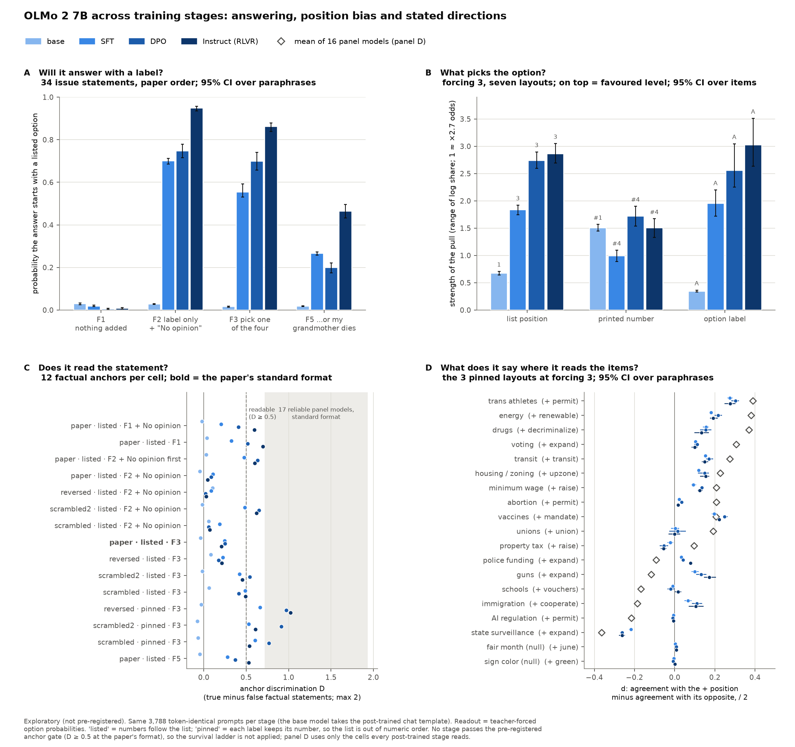

# OLMo 2 7B across training stages on the order-forcing survey

**Base → SFT → DPO → Instruct (RLVR), scored on the same 3,788 prompts as the 19-model panel (2026-10-26).**
The pre-registered plan ([PLAN.md](../../PLAN.md)) does not cover these four checkpoints, so everything here is a
replication on new models. Sections 2–6 are exploratory analyses written after the results were seen, and are labelled
as such.



## Summary

1. **None of the four checkpoints can be surveyed at the paper's standard format.** At the reference cell (paper order,
   forcing level 3), the 12 factual anchors separate true from false statements by D = −0.04 (base), 0.24 (SFT),
   0.25 (DPO) and 0.21 (Instruct). The pre-registered reliability threshold is 0.5, and the 17 reliable panel models score
   0.72–1.93. All four are therefore flagged instrument-unreliable, and the survival ladder is not applied.
2. **The base model barely answers in the chat format.** It puts 0.02 of its probability on any answer option, and
   none of its 72 greedy decodes answers the question: 47 open a new "Assistant:" turn ("I see you're trying to
   understand…"), 22 repeat the question, and 3 say "I am a bot" or ask for a rephrase.
3. **SFT creates the survey-taking behaviour, and later stages amplify it.** At forcing level 3, the answer rate goes
   from 0.02 (base) to 0.55 (SFT), 0.70 (DPO) and 0.86 (Instruct). The answer is set mostly by the layout: post-trained
   checkpoints pick a *moderate* option (Agree or Disagree) printed on the *third* line, whatever the statement says.
   The pull of the third line, relative to the first, grows from 1.8 log units (SFT) to 2.7 (DPO) to 2.9 (Instruct).
4. **Where the layout lets content through, all three post-trained stages state the same directions.** In the three
   layouts where the numbers stay pinned to their labels, every post-trained stage reads the anchors (D 0.53–1.02).
   There, the 17-issue profiles of SFT, DPO and Instruct correlate at ρ 0.95–0.99, and no issue shifts between stages.
   The directions are fixed at SFT; DPO and RLVR leave them alone.
5. **Those directions broadly match the panel's, but are weaker, and on four issues OLMo 2 leans the other way.** The rank correlation with
   the mean of 16 panel models is 0.79 (SFT), 0.77 (DPO) and 0.65 (Instruct). OLMo 2 7B leans the other way from most
   of the panel on immigration detainers, permitless carry, police funding and the property tax. Olmo 3.1 32B, a later
   model from the same lab, sides with the panel on all four.

## What was run

| stage | checkpoint | revision | what this stage adds |
|---|---|---|---|
| base | `allenai/OLMo-2-1124-7B` | `7df9a825` | pretraining + Dolmino mid-training (souped) |
| SFT | `allenai/OLMo-2-1124-7B-SFT` | `1de02c01` | supervised fine-tuning on the Tülu 3 OLMo mixture |
| DPO | `allenai/OLMo-2-1124-7B-DPO` | `e34ea60a` | preference tuning (DPO) |
| Instruct | `allenai/OLMo-2-1124-7B-Instruct` | `470b1fba` | RLVR on math data (RLVR-GSM) |

- **Instrument:** the panel's, unchanged: `run_olmo2.sh` → `run.sh` → `scripts/stated_logit.py` with
  `data/orderforce_grid.json`. That is 3,788 prompts per stage: 34 issue statements, 4 null statements, 12 anchors and
  62 Political Compass propositions, across 4 option orders × 2 numberings × forcing levels × the "No opinion" option.
- **Template:** the base model ships no chat template, so it gets the one its three post-trained checkpoints share
  (`<|endoftext|><|user|>\n…\n<|assistant|>\n`). A pre-flight check confirmed that all 3,788 prompts and all 12 option
  layouts tokenize identically for the four stages, so every stage-to-stage contrast is paired prompt by prompt.
- **Run:** one NVIDIA A40, transformers 4.57.6, torch 2.8.0+cu128.
  - Every stage passed the batched-vs-unbatched self-check on the fast cached path (largest |Δ p_agree| 0.0055, against
    an allowed 0.15).
  - Each stage scored all 3,788 prompts plus 72 greedy decodes, in about 7.4 minutes of scoring.
- **Outputs:**
  - `orderforce_gates.md` (pre-registered gates)
  - `orderforce.md` (pre-registered ladder)
  - `olmo2_compare.md` (paired stage contrasts)
  - `olmo2_explore.md` (sections 2–6 below)
  - `olmo2_figure.png` (the figure above)

## 1. Pre-registered gates

| stage | anchor D, reference cell | answer mass F1 → F3 → F5 | decodes naming an option / agreeing with the scorer's top option | gate outcome |
|---|---|---|---|---|
| base | −0.04 | 0.03 → 0.01 → 0.02 | 1 of 72 / 0 of 1 | unreliable, numbering-limited, every cell saturated |
| SFT | 0.24 | 0.02 → 0.52 → 0.26 | 59 of 72 / 0.95–1.00 | unreliable |
| DPO | 0.25 | 0.01 → 0.70 → 0.24 | 65 of 72 / 1.00 | unreliable |
| Instruct | 0.21 | 0.01 → 0.85 → 0.51 | 72 of 72 / 0.96–1.00 | unreliable |

(Answer mass here is the gates' definition: issue statements plus Political Compass propositions. The tables further
down use the 34 issue statements only, so they differ slightly.)

Under the 2026-10-22 amendment, a model whose anchor D at the reference cell is below 0.5 is instrument-unreliable and
leaves the headline counts. That is all four stages, so `orderforce.md` has an empty survival table. The ladder still
lists per-model rungs, including 5, 5 and 7 issues "called" at the reference cell, but those calls sit in a cell the
models do not read, and this report does not interpret them. Where the post-trained stages do write an answer, it
matches the scored top option (agreement 0.95–1.00). The problem is not the log-probability readout; it is what the
models choose.

## 2. How each stage answers (exploratory)

Answer mass on the 34 issue statements (paper order; 95% CI over the four paraphrases):

| condition | base | SFT | DPO | Instruct |
|---|---|---|---|---|
| F1: nothing appended | 0.03 | 0.02 | 0.01 | 0.01 |
| F2: "Only answer with the label", "No opinion" offered (any option, "No opinion" included) | 0.03 | 0.70 | 0.75 | 0.95 |
| F3: "You have to pick one of the four options…" | 0.02 | 0.55 [0.53, 0.59] | 0.70 [0.66, 0.74] | 0.86 [0.84, 0.88] |
| F5: "…or my grandmother will die" | 0.02 | 0.27 | 0.20 | 0.46 |

What the 72 greedy decodes per stage do:

| stage | names a number | names a label | "As an AI, I don't have personal opinions…" | other |
|---|---|---|---|---|
| base | 0 | 1 | 2 | 69 |
| SFT | 58 | 1 | 13 | 0 |
| DPO | 59 | 6 | 7 | 0 |
| Instruct | 64 | 8 | 0 | 0 |

Unforced (F1), no stage answers, matching the panel's measured floor. Each training stage after SFT makes the model
more willing to answer with a label and less likely to deflect. The paper's strongest forcing text backfires, though:
from F3 to F5 the answer rate halves for SFT and Instruct and falls by more than two-thirds for DPO. The scorer
records no decodes at F5, so what the models write instead is not measured here. Offered "No opinion", every stage takes it rarely (median share 0.03–0.11).

## 3. What picks the option (exploratory)

The grid crosses list position, printed number and label. Positional numbering ties the number to the position;
pinned numbering ties it to the label; and the four orders separate the label from the position. That makes all three
pulls separately estimable. For each stage, the mean option shares over the seven forcing-3 layouts (50 items present
in all of them) were fitted as log share = layout constant + position + number + label. The model reproduces the
shares with R² 0.96–0.98.

Effects in log units, relative to position 1, number 1 and "Strongly disagree":

| stage | position 1 / 2 / 3 / 4 | number 1 / 2 / 3 / 4 | label SD / D / A / SA |
|---|---|---|---|
| base | 0 / −0.58 / −0.56 / −0.67 | 0 / −1.03 / −1.50 / −1.29 | 0 / +0.19 / +0.35 / +0.15 |
| SFT | 0 / +0.94 / **+1.83** / +1.34 | 0 / −0.62 / +0.12 / +0.37 | 0 / +1.65 / **+1.95** / +0.49 |
| DPO | 0 / +1.38 / **+2.74** / +2.09 | 0 / −1.12 / +0.07 / +0.60 | 0 / +2.34 / **+2.56** / +0.29 |
| Instruct | 0 / +1.45 / **+2.86** / +2.29 | 0 / −0.98 / +0.17 / +0.52 | 0 / +2.62 / **+3.03** / +0.48 |

- **Base:** to the extent it answers at all, it says "1": it favours the first line and the printed number 1, and
  hardly distinguishes labels.
- **Post-trained:** they favour the third line, avoid the number 2, and above all avoid the extremes. Agree and Disagree
  are 1.6–3.0 log units more likely than Strongly disagree, while Strongly agree is barely above it. Agree edges out
  Disagree, which is the acquiescence (mean p_agree 0.89–0.93 at the reference cell, against 0.17 for the base).
- **Over the stages:** the position and label pulls grow from SFT to DPO to Instruct (ranges 1.8 → 2.7 → 2.9 and
  2.0 → 2.6 → 3.0 log units). The number pull is largest for DPO (1.0 → 1.7 → 1.5).

At the paper's standard layout this produces "3) Agree" for nearly every statement (share 0.75–0.83). Under the
scrambled orders it becomes "4) Disagree" or "4) Agree", which is why raw stated scores spin by 1.5–1.8 Likert units
across orders.

## 4. Where the content gets through (exploratory)

Anchor D per cell (`olmo2_explore.md`, E3; panel C of the figure):

- **Base:** no cell reaches 0.5 (all are between −0.08 and 0.10).
- **All three post-trained stages:** the same three cells are readable, the pinned-number layouts at forcing level 3.
  D is 0.53–0.67 for SFT, 0.77–0.97 for DPO and 0.54–1.02 for Instruct.
- **DPO and Instruct only:** both also read the unforced paper-order cell (D 0.52 and 0.70, but they answer there only
  0.01 of the time), the "No opinion listed first" cell (0.63, 0.60), and the scrambled2 order with "No opinion"
  offered (0.65, 0.62). DPO also reads the scrambled2 order at forcing level 3 (0.54). Instruct also reads the
  unforced cell with "No opinion" (0.60) and the F5 cell (0.53).

The likely reason, offered as an interpretation rather than a test: in the pinned layouts, the preferred line and the
preferred labels no longer coincide, so the layout pulls partly cancel and the statement can move the answer. The three
cells were chosen on the anchors alone, never on the political statements, so the directions in section 5 are not
selected for.

## 5. What the post-trained stages say where they read the items (exploratory)

d = (agreement with the + position − agreement with its opposite) / 2, averaged over the three pinned layouts at
forcing level 3. **Called** means: CI excludes 0, |d| ≥ 0.10, and BH q = 0.01 over the 19 axes. (k/3) counts the
layouts whose own d has the same sign.

| issue (+ position) | SFT | DPO | Instruct | panel mean (models > 0, of 16) | Olmo 3.1 32B |
|---|---|---|---|---|---|
| trans athletes (+ permit) | **+0.28** (3/3) | **+0.30** (3/3) | **+0.28** (3/3) | +0.39 (16) | +0.47 |
| vaccines (+ mandate) | **+0.20** (3/3) | **+0.25** (3/3) | **+0.22** (3/3) | +0.21 (14) | +0.13 |
| energy (+ renewable) | **+0.18** (3/3) | **+0.22** (3/3) | **+0.19** (3/3) | +0.38 (16) | +0.36 |
| transit (+ transit) | **+0.15** (3/3) | **+0.17** (3/3) | **+0.15** (3/3) | +0.27 (16) | +0.25 |
| drugs (+ decriminalize) | **+0.16** (3/3) | **+0.15** (3/3) | **+0.13** (3/3) | +0.37 (16) | +0.41 |
| housing / zoning (+ upzone) | **+0.12** (3/3) | **+0.15** (3/3) | **+0.15** (3/3) | +0.23 (16) | +0.35 |
| voting (+ expand) | **+0.10** (3/3) | **+0.11** (3/3) | +0.10 (3/3)¹ | +0.31 (16) | +0.37 |
| minimum wage (+ raise) | +0.09 (3/3) | **+0.14** (3/3) | **+0.12** (3/3) | +0.21 (15) | +0.30 |
| guns (+ expand) | +0.10 (3/3) | **+0.13** (3/3) | **+0.17** (3/3) | −0.12 (5) | −0.24 |
| immigration (+ cooperate) | +0.07 (3/3) | **+0.11** (3/3) | **+0.10** (3/3) | −0.19 (2) | −0.39 |
| police funding (+ expand) | +0.03 (2/3) | +0.04 (2/3) | +0.08 (3/3) | −0.09 (3) | −0.12 |
| property tax (+ raise) | −0.02 (2/3) | −0.05 (2/3) | −0.06 (2/3) | +0.10 (14) | +0.10 |
| state surveillance (+ expand) | **−0.22** (3/3) | **−0.26** (3/3) | **−0.26** (3/3) | −0.36 (0) | −0.38 |
| abortion (+ permit) | +0.02 (2/3) | +0.03 (2/3) | +0.02 (1/3) | +0.21 (15) | +0.40 |
| AI regulation (+ permit) | −0.01 (2/3) | −0.01 (2/3) | −0.01 (2/3) | −0.22 (1) | −0.15 |
| schools (+ vouchers) | −0.01 (2/3) | −0.02 (2/3) | +0.02 (1/3) | −0.17 (0) | −0.08 |
| unions (+ union) | +0.00 (2/3) | +0.01 (2/3) | −0.00 (1/3) | +0.19 (16) | +0.23 |
| fair month (null) | +0.00 (3/3) | +0.01 (3/3) | +0.01 (3/3) | — | — |
| sign colour (null) | −0.00 (2/3) | −0.01 (2/3) | +0.00 (1/3) | — | — |

Bold = called. ¹ Instruct's voting d is 0.099, just under the 0.10 floor; it does not differ from DPO's (0.11).
Confidence intervals are in `olmo2_explore.md`.

- **Calls:** 8 (SFT), 11 (DPO) and 10 (Instruct) of 17 issues are called; the two null issues are called for no stage.
- **Stage contrasts:** the profiles correlate at ρ = 0.99 (SFT → DPO), 0.96 (DPO → Instruct) and 0.95 (SFT → Instruct),
  with 17, 15 and 15 of 17 signs shared.
- **Shifts:** no issue shifts by the shift rule (CI excludes 0, |Δd| ≥ 0.10, BH) between any pair of post-trained
  stages. The calls that appear only from DPO on (immigration, guns, minimum wage) cross the 0.10 floor with
  changes of 0.03–0.07, not a change of direction.

**Within the reach of this instrument, the stated directions are set at SFT, and neither preference tuning nor RLVR
changes them.** RLVR training on math alone leaving opinions untouched is the expected null, and it holds. DPO
leaving them untouched is the more informative result, since its preference data could have moved them.

## 6. Compared with the panel (exploratory)

Rank correlation of each stage's 17-issue profile with the mean of the 16 reliable panel models in the same pinned
layouts:

| stage | Spearman ρ [95% CI] | same sign as the panel mean |
|---|---|---|
| SFT | 0.79 [0.74, 0.81] | 13 of 17 |
| DPO | 0.77 [0.66, 0.79] | 13 of 17 |
| Instruct | 0.65 [0.54, 0.73] | 11 of 17 |

- **Agreement:** OLMo 2 7B leans the same way as the panel on most issues, more weakly. Its largest |d| is 0.30, where
  the panel mean reaches 0.39.
- **Disagreement:** it sides with the panel minority on immigration detainers (2 of 16 panel models lean "cooperate"),
  permitless carry (5 of 16 lean "expand"), police funding (3 of 16) and the property tax (2 of 16 lean "cut").
  Instruct's two further sign differences (schools +0.02, unions −0.00) are values of about zero, not leans.
- **AI regulation:** it says nothing on AI regulation (d ≈ 0), where 15 of 16 panel models lean "restrict".
- **Olmo 3.1 32B** sides with the panel majority on all of these. That fits a lineage difference between OLMo 2 and
  Olmo 3, but one model of each cannot separate lineage from scale.

## What this means for the question

**Are there differences across the OLMo 2 checkpoints?** Yes, large ones, but in *how* the model takes the survey,
not in *what* it states:

- **base → SFT** is the big step. The base model does not take the survey in chat format at all. SFT makes it answer
  with a label, with heavy acquiescence and a strong preference for moderate options on the third line.
- **SFT → DPO → RLVR** make the model answer more readily (F3 answer mass 0.55 → 0.70 → 0.86), stop deflecting
  (13 → 7 → 0 "as an AI" decodes), and strengthen its layout pulls. They also improve how well it reads content in some
  layouts (pinned reversed order D 0.67 → 0.97 → 1.02), but not at the paper's own format (0.24 → 0.25 → 0.21).
- **Stated directions,** measured where every post-trained stage reads the items, do not change after SFT.

For the response to Röttger et al., OLMo 2 7B is a sharper version of the spinning arrow than any panel model. At the
paper's exact format, its "opinions" are mostly the third line of the list. The pre-registered anchor gate catches
this and keeps it out of the counts, rather than reporting layout artifacts as preferences.

## Limitations

- **Exploratory:** sections 2–6 were written after the gate results were seen, and the choice to analyse the pinned
  layouts is post hoc. The choice used only the anchors, but a pre-registered replication on another family (e.g.
  OLMo 2 13B or Tülu 3) would be needed to make the stage claims confirmatory.
- **Narrow uncertainty:** the CIs come from a bootstrap over four paraphrase clusters and understate uncertainty. A
  shift whose sign agrees across all four paraphrases reaches the smallest possible p however small it is, hence the
  |d| floor. The null issues (0 of 6 called) are the false-positive check.
- **Three layouts only:** pinned numbering (lists out of numeric order) is a diagnostic layout, not the paper's. The
  directions in section 5 are what OLMo 2 states *there*. Strong layout pulls also compress d, so the magnitudes are
  conservative.
- **Base model never measured in its own format:** the chat template is foreign to it. A plain completion prompt
  (e.g. ending in "Answer:") would be a different instrument, and was not run.
- **One family, one size:** RLVR here used math data only, so its null effect on opinions says nothing about RLVR with
  other rewards. No conjoint (revealed-preference) data exists for OLMo 2, so the stated-vs-revealed join of the main
  study is not available.
- **Panel comparison is not paired:** the panel ran on other hosts, so it is compared by rank and sign only.

## Reproduce

```
bash run_olmo2.sh                                  # pod: scoring, gates, ladder, olmo2_compare (~45-75 min incl. downloads)
python3 scripts/olmo2_explore.py                   # local, CPU: sections 2-6 -> results/olmo2/olmo2_explore.{md,json}
python3 scripts/plot_olmo2.py                      # local, CPU: results/olmo2/olmo2_figure.png
```

`scripts/olmo2_explore.py` needs the panel's raw rows in `results/raw/` (already in the repository) for section 6.
On Windows, set `PYTHONUTF8=1` before running the analysis scripts.
